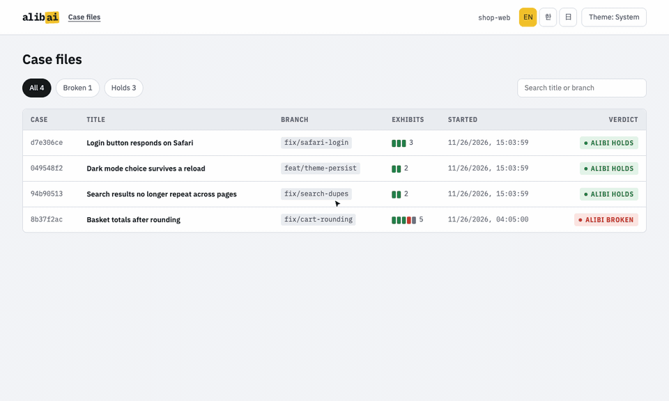
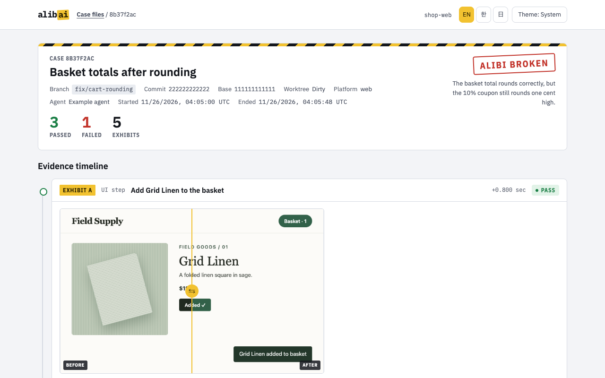

<h1 align="center">
  <picture>
    <source media="(prefers-color-scheme: dark)" srcset="docs/assets/logo-dark.png">
    
  </picture>
</h1>

<p align="center">
  <a href="README.md">English</a> |
  <a href="README.ko.md">한국어</a> |
  <a href="README.ja.md">日本語</a>
</p>

<p align="center"><strong>AI が「直した」と言うなら、証拠を見てみよう。</strong></p>
<p align="center">AI コーディングエージェントによるテストの証拠をローカルに記録します。ブラウザーのビューアーで、テスト実行ごとに変更前後のスクリーンショットを比較し、ロジック検証の入力、修正前後の結果、期待値を確認できます。</p>

<p align="center">
  <a href="https://www.npmjs.com/package/alibai"></a>
  <a href="https://github.com/kut7728/alibi-for-ai/releases"></a>
  
  
  <a href="LICENSE"></a>
</p>

<p align="center">
  
</p>

<p align="center">
  <a href="https://kut7728.github.io/alibi-for-ai/">ライブデモ</a> ·
  <a href="docs/assets/hero.mp4?raw=true">デモ動画をダウンロード（MP4）</a>
</p>

<details>
<summary>静止画を見る</summary>

<picture>
  <source media="(prefers-color-scheme: dark)" srcset="docs/assets/still-dark.png">
  
</picture>

</details>

| 記録コマンド | ビューアーで確認できる内容 |
| --- | --- |
| `alibai step` | 変更前後のスクリーンショットを比較するスライダー |
| `alibai check` | ロジックの修正前後の結果と期待値の比較 |
| `alibai run end` | テスト実行ごとの判定と概要 |

1 回のテスト実行を Case、各 UI 操作やロジック検証の証拠を Exhibit と呼びます。成功時の判定は **Alibi holds**、失敗時の判定は **Alibi broken** と表示されます。

## クイックスタート

Node.js 22 以降と Git が必要です。テスト対象の Git 作業ツリーで次のコマンドを実行すると、ビューアーが開きます。

```sh
npx alibai open
```

エージェントと連携する場合や、`alibai` コマンドを直接実行する場合は、CLI をグローバルにインストールします。

```sh
npm i -g alibai
```

ビューアーは Git 作業ツリーのルートにある `.alibai/runs/` から証拠を読み込みます。[エージェントスキル](#エージェントスキルの設定)または [CLI コマンド](#テストの証拠を記録する)でテストの証拠を記録できます。共有された実行記録を開くには、スクリーンショットを含む実行ディレクトリを丸ごと `.alibai/runs/` にコピーします。

### サンプルを試す

このリポジトリをクローンしたディレクトリで、サンプルデータを使った[カートの例](examples/cart-rounding)を一時的な Git 作業ツリーにコピーして開きます。

```sh
example_root="$(mktemp -d)"
git init -q "$example_root"
mkdir -p "$example_root/.alibai/runs"
cp -R examples/cart-rounding "$example_root/.alibai/runs/8b37f2ac-7506-4585-9d86-4a0e21c44c12"
(cd "$example_root" && npx alibai open)
```

<details>
<summary>ソースからビルドしてインストールする</summary>

```sh
git clone https://github.com/kut7728/alibi-for-ai.git
cd alibi-for-ai
npm ci
pack_dir="$(mktemp -d)"
npm pack --pack-destination "$pack_dir"
npm install --global "$pack_dir"/alibai-*.tgz
```

</details>

## エージェントスキルの設定

CLI をインストールしたら（[クイックスタート](#クイックスタート)を参照）、[共通スキル](skills/alibai/SKILL.md)を設定します。設定後は、エージェントに「alibai でテストして」と指示できます。

### Claude Code

このリポジトリの `skills/alibai` ディレクトリを `~/.claude/skills/` またはテスト対象プロジェクトの `.claude/skills/` にコピーします。Claude Code では `/alibai` でも呼び出せます。[Claude Code のスキルドキュメント](https://code.claude.com/docs/en/skills)

### Codex

`skills/alibai` ディレクトリをテスト対象プロジェクトの `.agents/skills/` またはユーザー用の `~/.agents/skills/` にコピーします。[Codex のスキルドキュメント](https://learn.chatgpt.com/docs/build-skills)

スキルを自動検出できない環境では、テスト対象プロジェクトの `AGENTS.md` に指示を追加します。alibai でのテストを頼まれたときに、このリポジトリの `skills/alibai/SKILL.md` を読んで従うように記述し、ファイルの絶対パスを指定してください。

### Cursor

`skills/alibai` ディレクトリをテスト対象プロジェクトの `.cursor/skills/` または `.agents/skills/` にコピーします。ユーザー単位で設定する場合は、`~/.cursor/skills/` または `~/.agents/skills/` を使います。[Cursor のスキルドキュメント](https://cursor.com/docs/skills)

スキルを自動検出できない環境では、`.cursor/rules/alibai.mdc` に **Apply Intelligently** タイプのルールを作成します。ルールの説明には alibai でのテスト依頼に適用することを書き、本文には共通スキルの絶対パスを指定して、そのファイルを読んで従うように記述します。[Cursor のルールドキュメント](https://cursor.com/docs/rules)

## テストの証拠を記録する

テスト対象の Git 作業ツリーで以下を実行します。`before.png` と `after.png` は、あらかじめ撮影したスクリーンショットのパスに置き換えてください。相対パスはコマンドを実行したディレクトリを基準に解決されます。

```sh
alibai run start --title "Login fix" --platform flutter --agent Codex
alibai step --action "Tap Sign in" --before before.png --after after.png --result pass
alibai check --target validateLogin --input '{"email":"a@example.com"}' \
  --before false --after true --expected true --result pass
alibai run end --verdict pass --summary "Login succeeds with a valid email."
alibai list --json
```

検証で例外が発生した場合も、実行を終了する前に記録できます。

```sh
alibai check --target parseAge --input '"invalid"' --before null --error TypeError --result fail
```

- `run start` の必須項目はタイトルのみです。プラットフォームには `flutter`、`ios`、`android`、`web` を指定でき、デフォルトは `web` です。エージェント名は省略できます。
- `step` では `--before` または `--after` でスクリーンショットを 1 枚以上指定します。拡張子は `.png`、`.jpg`、`.jpeg`、`.webp` に対応し、大文字と小文字は区別しません。操作の順番は 1 から始まり、`--note` のデフォルト値は空文字列です。
- `check` の `--input`、`--before`、`--after`、および任意の `--expected` には JSON 値を渡します。`--error` でエラーコード、例外名、またはメッセージを渡す場合、`--after` は省略できます。`--after null` を指定すると JSON の `null` が記録されます。
- 負の数は `--before=-1` のように渡します。JSON 文字列は `--after '"ok"'` のように JSON 用の二重引用符を含めます。JavaScript の安全な整数範囲（±9,007,199,254,740,991）を超える整数は丸められることがあるため、正確な値が必要な場合は JSON 文字列として渡してください。
- `step` と `check` の `--result`、および `run end` の `--verdict` には、`pass`、`fail`、`info` を指定します。項目ごとの結果はデフォルトで `info` になり、実行を終了する際は判定の指定が必須です。`--summary` を省略すると、判定を含む 1 行の概要が自動で記録されます。
- `step`、`check`、`run end` は、開始時刻が最も新しい未終了の実行を対象にします。実行を指定するには `--run <id>` を使います。終了した実行には項目を追加できません。

記録コマンドは実行 ID と `run.json` の絶対パスを出力します。`--json` を付けると、記録コマンドは `{"id":"…","path":"…"}` を、`list` は `{"runs":[…],"invalidRuns":[…]}` を標準出力に書き出します。`runs` は新しい順に並び、未終了の実行の `verdict` は `null` です。`invalidRuns` には、読み込みや検証ができなかった実行が `{"id":"…","path":"…","error":"…"}` の形式で入ります。通常の `list` 出力と、実行を自動選択する記録コマンドは、読み込めない実行をスキップし、標準エラー出力に警告を表示します。記録コマンドでは `--json` を付けても警告は表示されます。`--run <id>` を指定すると、その実行に直接アクセスします。JSON モードでは、CLI エラーは終了コード 1 になり、標準エラー出力に `{"error":"…"}` が出力されます。結果や判定が `fail` でも、記録に成功すれば終了コードは 0 です。

## ブラウザーで証拠を確認する

記録がある Git 作業ツリーで `alibai open` を実行します。デフォルトのブラウザーが開きます。ターミナルに表示される `http://127.0.0.1:…/` に直接アクセスすることもできます。ビューアーはローカルのループバックアドレス `127.0.0.1` でのみ接続を受け付けます。`alibai open --json` は `{"url":"…"}` を出力します。`Ctrl+C` でサーバーを停止できます。記録を追加したら、ページを再読み込みしてください。

ビューアーの一覧には読み込めない記録も表示されます。タイムラインでは UI 操作を `order` 順、ロジック検証を記録順に並べます。両方の列の次の項目にタイムスタンプがある場合は記録時刻を比較し、時刻が同じか、どちらかに時刻がない場合は UI 操作を先に表示します。

ビューアー上部の EN / 한 / 日 ボタンで言語を切り替えられます。初回表示の言語を指定するには、`alibai open --lang ko` のように `en`、`ko`、`ja` のいずれかを渡します。言語は URL の `lang`、同じビューアー URL に保存された設定、ブラウザーの言語設定の順に決まり、デフォルトは英語です。

## 記録形式と Git の比較基準

実行の開始時に Git のブランチ、コミット、作業ツリーの状態を保存します。未追跡ファイルも含めて `git status --porcelain` に出力があれば、`git.dirty` は `true` です。`--base <ref>` を指定すると、そのローカルコミットを比較基準にします。解決できない ref を指定するとエラーになります。デフォルトでは、`origin/HEAD`、`origin/main`、ローカルの `main`、`origin/master`、ローカルの `master` の順に、現在のコミットとは異なる共通祖先を探します。見つからなければ現在のコミットの最初の親コミットを使います。比較基準や HEAD のコミットが存在しない場合、該当する SHA は `null` になります。detached HEAD の場合、ブランチも `null` になります。

[バージョン 1 のスキーマ](src/run.schema.json)に従った記録を、Git 作業ツリーのルートにある `.alibai/runs/<run-id>/run.json` に保存します。スクリーンショットは実行ディレクトリの `screenshots/` にコピーされ、JSON には実行ディレクトリからの相対パスが入ります。最初の実行を開始するときに `.alibai/.gitignore` を作成し、証拠を Git の追跡対象から外します。

<details>
<summary>タイムスタンプ、作業ツリーのスナップショット、ロック</summary>

新しい UI 操作とロジック検証には UTC の `createdAt`、終了した実行には UTC の `endedAt` を記録します。既存のバージョン 1 の記録は、これらのタイムスタンプや `git.dirty` がなくても読み込めます。

開始時または終了時に未コミットの変更がある場合、それぞれ `git.startChanges` または `git.endChanges` にスナップショットを記録します。`paths` は作業ツリーのルートからの相対パスで、追跡ファイルのステージ済みおよび未ステージの変更と、Git の無視対象に含まれない未追跡ファイルが対象です。ルートの `.alibai` は除外し、名前を変更したファイルは変更前と変更後の両方のパスを記録します。ビューアーの作業ツリー情報を展開すると、各時点のファイル一覧を確認できます。

`diffSha256` は、HEAD とインデックスの差分パッチ、インデックスと作業ツリーの差分パッチ、未追跡ファイルのパスと内容から計算します。各パッチについて、バイト長を 10 進数で表した文字列、改行、パッチのバイト列の順にハッシュに入れます。両方のパッチに、デフォルトのパス順、`a/` と `b/` の接頭辞、Myers アルゴリズム、コンテキスト 3 行、ハンク間コンテキスト 0 行、インデントヒューリスティック、完全なオブジェクト ID を使います。色付け、リネーム検出、外部 diff、textconv は無効にします。

未追跡の項目は、ルートからの相対パスの生バイト列でソートします。各項目について、種類（`f` または `l`）、パスのバイト長と改行、パスの生バイト列、内容の 32 バイトの SHA-256 ダイジェストの順にハッシュに入れます。シンボリックリンクでは、リンクに格納されている参照先のパスをハッシュ化します。スナップショットにはパスとハッシュのみを保存します。Git の読み込み結果や個々の未追跡ファイルが 32 MiB を超えた場合、入力を読み込めない場合、または HEAD やハッシュ化の対象がない場合は、パスを保存し、ハッシュを `null` にします。Git の属性やチェックアウト設定によってパッチの内容が変わったり、読み込みの合間に変更が入ったりすると、ハッシュが変わることがあります。

Git の状態を読み込めなければ、その時点のスナップショットを `null` として記録します。開始時の読み込みに失敗した場合は、`git.dirty` も省略します。変更されたパスがなければ、スナップショットのフィールドを省略します。既存のバージョン 1 の記録にも、このフィールドがない場合があります。Git 作業ツリーの外で記録コマンドを実行するとエラーになります。

同じ実行に書き込むコマンドは、ロックが解放されるまで最大 5 秒待ちます。ロックに有効期限はありません。強制終了後にロックが残った場合は、その実行への書き込みやロックの解放を待っているプロセスがすべて終了したことを確認してください。そのうえで、エラーに表示された `rmdir -- '<絶対パス>/.lock'` コマンドで空のロックディレクトリを削除し、再試行します。記録は一時ファイルに書き込んでから置き換えます。

</details>

## 開発とテスト

テストは `npm test` で実行します。任意のブラウザーレンダリングテストも実行するには、Chromium 系ブラウザーの実行ファイルのパスを `ALIBAI_TEST_CHROMIUM` に指定します。macOS の Chrome を使う場合は、次のコマンドを実行します。

```sh
ALIBAI_TEST_CHROMIUM='/Applications/Google Chrome.app/Contents/MacOS/Google Chrome' npm test
```
