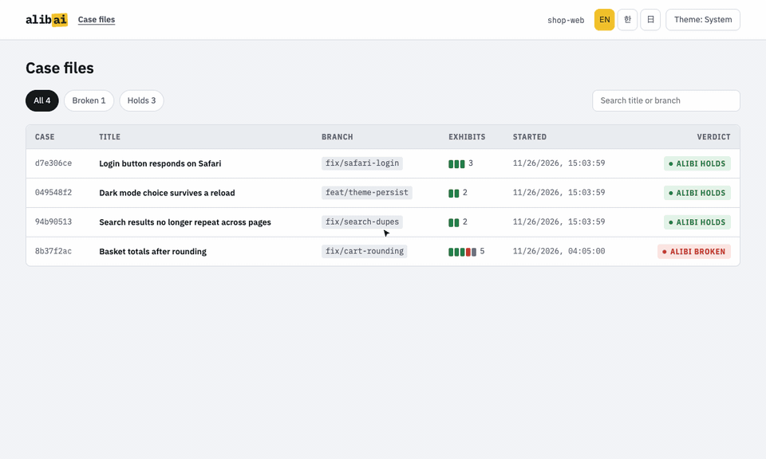
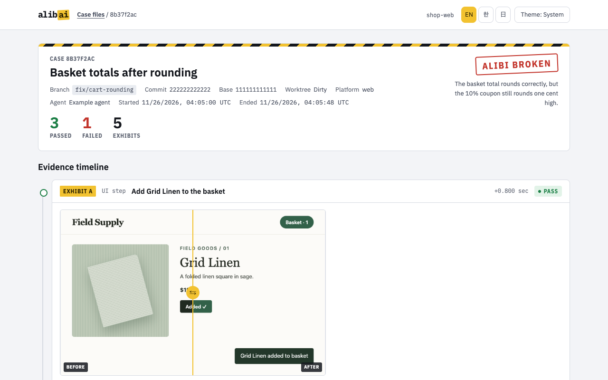

<h1 align="center">
  <picture>
    <source media="(prefers-color-scheme: dark)" srcset="docs/assets/logo-dark.png">
    
  </picture>
</h1>

<p align="center">
  <a href="README.md">English</a> |
  <a href="README.ko.md">한국어</a> |
  <a href="README.ja.md">日本語</a>
</p>

<p align="center"><strong>AI가 고쳤다고요? 증거를 확인하세요.</strong></p>
<p align="center">AI 코딩 에이전트의 테스트 증거를 로컬에 기록하고 브라우저에서 확인합니다. 실행별로 UI 전후 스크린샷을 비교하고, 로직 검사의 입력과 수정 전후 결과, 기댓값을 확인할 수 있습니다.</p>

<p align="center">
  <a href="https://www.npmjs.com/package/alibai"></a>
  <a href="https://github.com/kut7728/alibi-for-ai/releases"></a>
  
  
  <a href="LICENSE"></a>
</p>

<p align="center">
  
</p>

<p align="center">
  <a href="https://kut7728.github.io/alibi-for-ai/">라이브 데모</a> ·
  <a href="docs/assets/hero.mp4?raw=true">데모 영상 (MP4 다운로드)</a>
</p>

<details>
<summary>정지 화면 보기</summary>

<picture>
  <source media="(prefers-color-scheme: dark)" srcset="docs/assets/still-dark.png">
  
</picture>

</details>

| 기록 명령 | 뷰어에서 확인 |
| --- | --- |
| `alibai step` | UI 전후 스크린샷 슬라이더 |
| `alibai check` | 로직의 수정 전후 결과와 기댓값 비교 |
| `alibai run end` | 실행별 판정과 요약 |

테스트 실행 하나가 Case에 해당하며, UI 단계와 로직 검사를 각각 Exhibit로 기록합니다. 통과 판정은 **Alibi holds**, 실패 판정은 **Alibi broken**으로 표시됩니다.

## 빠른 시작

Node.js 22 이상과 Git이 필요합니다. 테스트 대상 Git 작업 트리에서 npm으로 뷰어를 바로 엽니다.

```sh
npx alibai open
```

에이전트에서 사용하거나 `alibai` 명령을 직접 실행하려면 전역으로 설치합니다.

```sh
npm i -g alibai
```

뷰어는 Git 작업 트리 루트의 `.alibai/runs/`에서 증거를 읽습니다. [에이전트 스킬](#에이전트-스킬-설치)이나 [CLI 명령](#기록하기)으로 테스트를 기록할 수 있습니다. 다른 사람의 기록을 열려면 스크린샷을 포함한 실행 디렉터리 전체를 `.alibai/runs/`에 복사합니다.

### 예제 실행

이 저장소를 클론한 디렉터리에서 가상 데이터로 만든 [장바구니 예제](examples/cart-rounding)를 임시 Git 작업 트리에 복사해 엽니다.

```sh
example_root="$(mktemp -d)"
git init -q "$example_root"
mkdir -p "$example_root/.alibai/runs"
cp -R examples/cart-rounding "$example_root/.alibai/runs/8b37f2ac-7506-4585-9d86-4a0e21c44c12"
(cd "$example_root" && npx alibai open)
```

<details>
<summary>소스에서 빌드해 설치하기</summary>

```sh
git clone https://github.com/kut7728/alibi-for-ai.git
cd alibi-for-ai
npm ci
pack_dir="$(mktemp -d)"
npm pack --pack-destination "$pack_dir"
npm install --global "$pack_dir"/alibai-*.tgz
```

</details>

## 에이전트 스킬 설치

CLI를 설치한 뒤([빠른 시작](#빠른-시작) 참고) [공용 스킬](skills/alibai/SKILL.md)을 연결합니다. 연결 후 에이전트에 `alibai로 테스트해줘`라고 요청할 수 있습니다.

### Claude Code

이 저장소의 `skills/alibai` 디렉터리를 `~/.claude/skills/` 또는 테스트 대상 프로젝트의 `.claude/skills/`에 복사합니다. Claude Code에서 `/alibai`로도 실행할 수 있습니다. [Claude Code 스킬 문서](https://code.claude.com/docs/en/skills)

### Codex

`skills/alibai` 디렉터리를 테스트 대상 프로젝트의 `.agents/skills/` 또는 사용자용 `~/.agents/skills/`에 복사합니다. [Codex 스킬 문서](https://learn.chatgpt.com/docs/build-skills)

스킬 자동 검색을 사용할 수 없는 환경에서는 프로젝트의 `AGENTS.md`에 Alibai 테스트 요청 시 이 저장소의 `skills/alibai/SKILL.md`를 읽고 따르라는 지침을 추가하고, 파일의 실제 절대 경로를 적습니다.

### Cursor

`skills/alibai` 디렉터리를 테스트 대상 프로젝트의 `.cursor/skills/` 또는 `.agents/skills/`에 복사합니다. 사용자용 경로는 `~/.cursor/skills/` 또는 `~/.agents/skills/`입니다. [Cursor 스킬 문서](https://cursor.com/docs/skills)

스킬 자동 검색을 사용할 수 없는 환경에서는 `.cursor/rules/alibai.mdc`에 **Apply Intelligently** 규칙을 만듭니다. 설명에는 Alibai 테스트 요청 시 적용한다고 적고, 본문에는 공용 스킬의 실제 절대 경로를 읽고 따르라고 적습니다. [Cursor 규칙 문서](https://cursor.com/docs/rules)

## 기록하기

테스트 대상 Git 작업 트리에서 실행합니다. `before.png`와 `after.png`는 미리 캡처한 스크린샷 경로로 바꿉니다. 파일 경로는 명령을 실행한 디렉터리 기준입니다.

```sh
alibai run start --title "Login fix" --platform flutter --agent Codex
alibai step --action "Tap Sign in" --before before.png --after after.png --result pass
alibai check --target validateLogin --input '{"email":"a@example.com"}' \
  --before false --after true --expected true --result pass
alibai run end --verdict pass --summary "Login succeeds with a valid email."
alibai list --json
```

예외가 발생한 검사도 실행을 종료하기 전에 기록할 수 있습니다.

```sh
alibai check --target parseAge --input '"invalid"' --before null --error TypeError --result fail
```

- `run start`는 제목만 필수입니다. 플랫폼은 `flutter`, `ios`, `android`, `web` 중 하나이며 기본값은 `web`입니다. 에이전트 이름은 선택 사항입니다.
- `step`에는 `--before` 또는 `--after` 스크린샷이 하나 이상 필요합니다. 파일 확장자는 대소문자 구분 없이 `.png`, `.jpg`, `.jpeg`, `.webp`를 지원합니다. 순서는 1부터 기록하며 `--note`의 기본값은 빈 문자열입니다.
- `check`의 `--input`, `--before`, `--after`, 선택 항목인 `--expected`는 JSON 값입니다. `--error`에 오류 코드나 예외 이름 또는 메시지를 전달하면 `--after`를 생략할 수 있습니다. `--after null`은 JSON `null`을 기록합니다.
- 음수는 `--before=-1`처럼 전달할 수 있고, JSON 문자열은 `--after '"ok"'`처럼 JSON 따옴표를 포함합니다. JavaScript 안전 정수 범위(±9,007,199,254,740,991)를 벗어나는 정수는 반올림될 수 있으므로 정확한 값이 필요하면 JSON 문자열로 전달합니다.
- `step`과 `check`의 `--result`, `run end`의 `--verdict`에는 `pass`, `fail`, `info`를 사용합니다. 항목의 결과는 기본 `info`이며, 실행을 종료할 때는 판정을 지정합니다. `--summary`를 생략하면 판정을 담은 한 줄이 자동으로 기록됩니다.
- `step`, `check`, `run end`는 가장 최근에 시작한 열린 실행에 기록합니다. 특정 실행을 지정하려면 `--run <id>`를 사용합니다. 종료한 실행에는 항목을 추가할 수 없습니다.

기록 명령은 실행 ID와 `run.json`의 절대 경로를 출력합니다. `--json`을 쓰면 기록 명령은 `{"id":"…","path":"…"}`를, `list`는 `{"runs":[…],"invalidRuns":[…]}`를 stdout에 출력합니다. `runs`는 최신순이며 열린 실행의 `verdict`는 `null`입니다. `invalidRuns`에는 읽거나 검증할 수 없는 실행의 `{"id":"…","path":"…","error":"…"}` 항목이 담깁니다. 일반 `list` 출력과 기본 실행을 선택하는 기록 명령은 읽을 수 없는 실행을 건너뛰고 stderr에 경고를 출력합니다. 이 경고는 기록 명령에 `--json`을 붙여도 표시됩니다. `--run <id>`를 지정하면 해당 실행에 바로 접근합니다. `--json`에서 CLI 오류는 종료 코드 1과 함께 stderr에 `{"error":"…"}`로 출력됩니다. `fail` 결과나 판정도 기록에 성공하면 종료 코드는 0입니다.

## 브라우저에서 증거 보기

기록이 있는 Git 작업 트리에서 `alibai open`을 실행합니다. 기본 브라우저가 열리며 터미널에 출력된 `http://127.0.0.1:…/` 주소로 직접 접속할 수도 있습니다. 뷰어는 로컬 루프백 주소 `127.0.0.1`에서만 접속을 받습니다. `alibai open --json`은 `{"url":"…"}`을 출력합니다. `Ctrl+C`로 서버를 종료합니다. 기록을 추가한 뒤에는 페이지를 새로고침하면 됩니다.

뷰어는 읽을 수 없는 기록을 목록에 표시합니다. 타임라인은 UI 단계의 `order`와 로직 검사의 저장 순서를 유지하면서, 각 시퀀스의 다음 항목에 시간이 모두 있으면 기록 시각을 비교합니다. 시간이 같거나 한쪽에 시각이 없으면 UI 단계를 먼저 표시합니다.

뷰어 상단의 EN / 한 / 日 버튼으로 언어를 바꿀 수 있습니다. 처음 열 때 언어를 지정하려면 `alibai open --lang ko`처럼 `en`, `ko`, `ja` 중 하나를 전달합니다. 주소의 `lang` 값, 같은 뷰어 주소에 저장된 선택, 브라우저의 언어 설정 순으로 적용하며 기본값은 영어입니다.

## 포맷과 Git 기준

실행을 시작한 시점의 Git 브랜치, 커밋, 작업 트리 상태를 저장합니다. `git.dirty`는 추적되지 않은 파일을 포함한 `git status --porcelain` 출력이 있을 때 `true`입니다. `--base <ref>`를 지정하면 해당 로컬 커밋을 기준으로 사용하며, 해석할 수 없는 ref는 오류로 처리합니다. 기본 기준은 현재 커밋과 다른 공통 조상을 `origin/HEAD` → `origin/main` → 로컬 `main` → `origin/master` → 로컬 `master` 순으로 찾아 사용합니다. 없으면 현재 커밋의 첫 번째 부모를 사용합니다. 기준이나 HEAD 커밋이 없으면 해당 SHA는 `null`이며, detached HEAD의 브랜치도 `null`입니다.

Git 작업 트리 루트의 `.alibai/runs/<run-id>/run.json`에 [버전 1 스키마](src/run.schema.json)를 따르는 기록을 저장합니다. 스크린샷은 실행 디렉터리의 `screenshots/`에 복사되며, JSON에는 실행 디렉터리 기준 상대 경로가 들어갑니다. 처음 실행을 시작할 때 `.alibai/.gitignore`를 만들어 증거를 Git에서 제외합니다.

<details>
<summary>타임스탬프, 작업 트리 스냅샷과 잠금</summary>

새 UI 단계와 로직 검사에는 UTC `createdAt`, 종료한 실행에는 UTC `endedAt`을 기록합니다. 기존 버전 1 기록은 이 시간이나 `git.dirty`가 없어도 읽을 수 있습니다.

시작과 종료 시점에 미커밋 변경이 있으면 각각 `git.startChanges`, `git.endChanges`에 스냅샷을 기록합니다. `paths`는 작업 트리 루트 기준이며, 추적 파일의 스테이징된 변경과 작업 트리 변경, Git이 무시하지 않는 미추적 파일을 포함합니다. 루트의 `.alibai`는 제외하고, 이름이 바뀐 파일은 이전 경로와 새 경로로 기록합니다. 뷰어의 작업 트리 정보에서 각 시점의 파일 목록을 펼쳐 볼 수 있습니다.

`diffSha256`은 HEAD 대비 인덱스 패치, 인덱스 대비 작업 트리 패치, 미추적 파일의 경로와 내용에서 계산합니다. 두 패치의 바이트 길이를 각각 십진수와 개행으로 기록한 뒤 패치 바이트를 순서대로 해시에 넣습니다. 두 패치 모두 기본 경로 순서, `a/`와 `b/` 접두사, Myers 알고리즘, 문맥 3줄, 변경 덩어리 사이 문맥 0줄, 들여쓰기 휴리스틱 및 전체 객체 ID를 사용합니다. 색상, 이름 변경 감지, 외부 diff, textconv는 끕니다.

미추적 항목은 루트 기준 경로의 원본 바이트 순으로 정렬합니다. 각 항목의 종류(`f` 또는 `l`), 경로의 바이트 길이와 개행, 경로의 원본 바이트, 내용의 32바이트 SHA-256을 차례로 해시에 넣습니다. 심볼릭 링크는 대상 파일 대신 링크에 저장된 경로를 해시합니다. 패치와 파일 본문은 저장하지 않습니다. Git 읽기나 미추적 파일 하나가 32 MiB를 넘거나, 입력을 읽을 수 없거나, HEAD 또는 해시할 입력이 없으면 경로는 저장하고 해시는 `null`로 기록합니다. Git 속성이나 체크아웃 설정이 바꾼 패치 내용과 실행 중 파일 읽기 사이에 일어난 변경은 해시에 영향을 줄 수 있습니다.

Git 상태 읽기가 실패하면 해당 시점의 스냅샷을 `null`로 기록하고, 시작 시점이면 `git.dirty`를 생략합니다. 변경 경로가 없으면 스냅샷 필드를 생략합니다. 기존 버전 1 기록에도 이 필드가 없을 수 있습니다. Git 작업 트리가 아닌 곳에서는 기록 명령이 오류를 반환합니다.

같은 실행에 쓰는 명령은 최대 5초 동안 잠금을 기다립니다. 잠금은 시간이 지나도 자동으로 해제되지 않습니다. 강제 종료 뒤 잠금이 남아 있다면 해당 실행에 쓰거나 대기 중인 프로세스가 모두 종료됐는지 먼저 확인합니다. 그다음 오류에 표시된 `rmdir -- '<절대 경로>/.lock'` 명령으로 빈 잠금 디렉터리를 제거하고 다시 시도합니다. 기록은 임시 파일을 작성한 뒤 교체하는 방식으로 저장됩니다.

</details>

## 개발 및 테스트

테스트는 `npm test`로 실행합니다. 브라우저 렌더링 테스트는 선택 실행입니다. Chromium 계열 브라우저의 실행 파일 경로를 `ALIBAI_TEST_CHROMIUM`에 지정합니다. macOS의 Chrome에서는 다음 명령을 사용합니다.

```sh
ALIBAI_TEST_CHROMIUM='/Applications/Google Chrome.app/Contents/MacOS/Google Chrome' npm test
```
