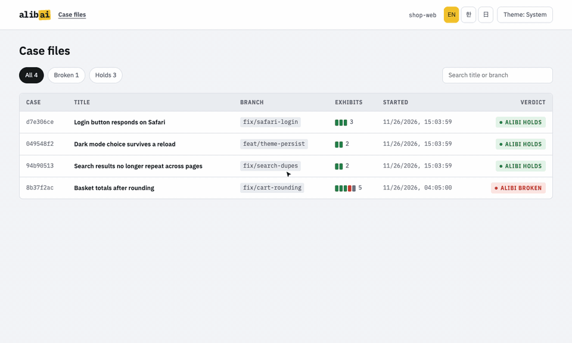
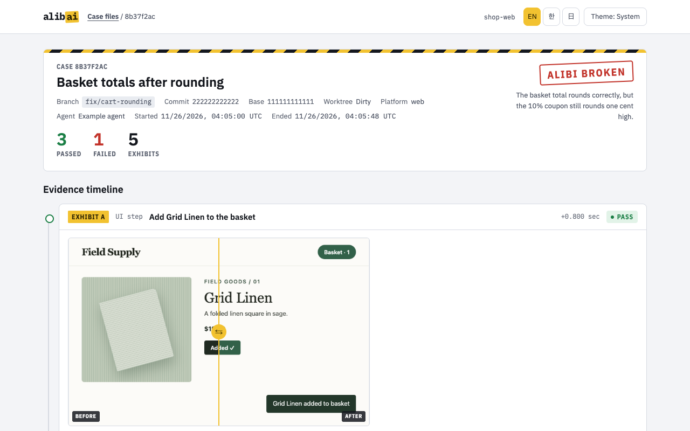

<h1 align="center">
  <picture>
    <source media="(prefers-color-scheme: dark)" srcset="docs/assets/logo-dark.png">
    
  </picture>
</h1>

<p align="center">
  <a href="README.md">English</a> |
  <a href="README.ko.md">한국어</a> |
  <a href="README.ja.md">日本語</a>
</p>

<p align="center"><strong>Your AI says it's fixed. Here's the evidence.</strong></p>
<p align="center">Alibi for AI records test evidence from AI coding agents on your machine. Review each run in your browser to compare before-and-after screenshots and see each logic check's input, results before and after the fix, and expected value.</p>

<p align="center">
  <a href="https://www.npmjs.com/package/alibai"></a>
  <a href="https://github.com/kut7728/alibi-for-ai/releases"></a>
  
  
  <a href="LICENSE"></a>
</p>

<p align="center">
  
</p>

<p align="center">
  <a href="https://kut7728.github.io/alibi-for-ai/">Live demo</a> ·
  <a href="docs/assets/hero.mp4?raw=true">Download demo video (MP4)</a>
</p>

<details>
<summary>View a still image</summary>

<picture>
  <source media="(prefers-color-scheme: dark)" srcset="docs/assets/still-dark.png">
  
</picture>

</details>

| Record with | Review in the viewer |
| --- | --- |
| `alibai step` | Before-and-after screenshots with a comparison slider |
| `alibai check` | Logic results before and after the fix, alongside the expected value |
| `alibai run end` | Verdict and summary for the run |

Each test run is a Case, and each UI step or logic check is an Exhibit. A passing verdict reads **Alibi holds**, and a failing verdict reads **Alibi broken**.

## Quick start

You'll need Node.js 22 or later and Git. From the Git working tree you want to test, open the viewer with `npx`.

```sh
npx alibai open
```

To use Alibai with an agent or run `alibai` directly, install the CLI globally.

```sh
npm i -g alibai
```

The viewer reads evidence from `.alibai/runs/` at the root of your Git working tree. Record tests with the [agent skill](#set-up-the-agent-skill) or the [CLI](#record-test-evidence). To open a run someone shared with you, copy the entire run directory, including its screenshots, into `.alibai/runs/`.

### Try the example

From a clone of this repository, copy the [shopping cart example](examples/cart-rounding) into a temporary Git working tree and open it. This example uses sample data.

```sh
example_root="$(mktemp -d)"
git init -q "$example_root"
mkdir -p "$example_root/.alibai/runs"
cp -R examples/cart-rounding "$example_root/.alibai/runs/8b37f2ac-7506-4585-9d86-4a0e21c44c12"
(cd "$example_root" && npx alibai open)
```

<details>
<summary>Build and install from source</summary>

```sh
git clone https://github.com/kut7728/alibi-for-ai.git
cd alibi-for-ai
npm ci
pack_dir="$(mktemp -d)"
npm pack --pack-destination "$pack_dir"
npm install --global "$pack_dir"/alibai-*.tgz
```

</details>

## Set up the agent skill

First install the CLI (see [Quick start](#quick-start)), then set up the [shared skill](skills/alibai/SKILL.md). Once it's set up, ask your agent to "test this with alibai."

### Claude Code

Copy this repository's `skills/alibai` directory into `~/.claude/skills/` or into `.claude/skills/` in the project you want to test. You can also invoke it with `/alibai` in Claude Code. [Claude Code skills documentation](https://code.claude.com/docs/en/skills)

### Codex

Copy the `skills/alibai` directory into `.agents/skills/` in the project you want to test or into `~/.agents/skills/` for your user account. [Codex skills documentation](https://learn.chatgpt.com/docs/build-skills)

If automatic skill discovery is unavailable, add an instruction to the project's `AGENTS.md` telling Codex to read and follow this repository's `skills/alibai/SKILL.md` whenever you ask it to test with Alibai. Include the file's absolute path.

### Cursor

Copy the `skills/alibai` directory into `.cursor/skills/` or `.agents/skills/` in the project you want to test. For user-wide setup, use `~/.cursor/skills/` or `~/.agents/skills/`. [Cursor skills documentation](https://cursor.com/docs/skills)

If automatic skill discovery is unavailable, create an **Apply Intelligently** rule in `.cursor/rules/alibai.mdc`. In the rule description, say it applies to Alibai test requests. In the body, give the absolute path to the shared skill and tell Cursor to read and follow it. [Cursor rules documentation](https://cursor.com/docs/rules)

## Record test evidence

Run these commands in the Git working tree you want to test. Replace `before.png` and `after.png` with paths to screenshots you've already captured. Relative paths resolve from the directory where you run the command.

```sh
alibai run start --title "Login fix" --platform flutter --agent Codex
alibai step --action "Tap Sign in" --before before.png --after after.png --result pass
alibai check --target validateLogin --input '{"email":"a@example.com"}' \
  --before false --after true --expected true --result pass
alibai run end --verdict pass --summary "Login succeeds with a valid email."
alibai list --json
```

You can also record a check that threw an exception before you end the run.

```sh
alibai check --target parseAge --input '"invalid"' --before null --error TypeError --result fail
```

- `run start` requires only a title. The platform can be `flutter`, `ios`, `android`, or `web` and defaults to `web`. The agent name is optional.
- `step` requires at least one screenshot via `--before` or `--after`. Supported extensions are `.png`, `.jpg`, `.jpeg`, and `.webp`, regardless of case. Step numbering starts at 1, and `--note` defaults to an empty string.
- `check` takes JSON values for `--input`, `--before`, `--after`, and the optional `--expected`. If you pass an error code, exception name, or message with `--error`, you can omit `--after`. Use `--after null` to record JSON `null`.
- Pass negative numbers as in `--before=-1`. For JSON strings, include the JSON quotes as in `--after '"ok"'`. Values outside JavaScript's safe integer range (±9,007,199,254,740,991) can round. Pass those integers as JSON strings if you need to preserve the exact value.
- Use `pass`, `fail`, or `info` for `--result` in `step` and `check` and for `--verdict` in `run end`. An entry's result defaults to `info`. Ending a run requires a verdict. If you omit `--summary`, Alibai records a one-line summary with the verdict.
- `step`, `check`, and `run end` target the most recently started open run. Use `--run <id>` to select a specific run. You can't add entries to a run after it ends.

Recording commands print the run ID and the absolute path to `run.json`. With `--json`, they write `{"id":"…","path":"…"}` to stdout, and `list` writes `{"runs":[…],"invalidRuns":[…]}`. The `runs` array is newest first, and open runs have a `null` verdict. The `invalidRuns` array contains `{"id":"…","path":"…","error":"…"}` entries for runs that cannot be read or validated.

Plain `list` output and recording commands that select the default run skip unreadable runs and warn on stderr. Recording commands print these warnings even with `--json`. Pass `--run <id>` to access a run directly. In JSON mode, CLI errors are written to stderr as `{"error":"…"}` with exit code 1. A successfully recorded `fail` result or verdict still exits with code 0.

## Review evidence in the browser

Run `alibai open` in the Git working tree that contains your records. It opens your default browser, or you can visit the `http://127.0.0.1:…/` URL printed in the terminal. The viewer listens on the local loopback address `127.0.0.1`. `alibai open --json` prints `{"url":"…"}`. Press `Ctrl+C` to stop the server. Refresh the page after adding records.

The viewer also lists runs it can't read. The timeline preserves UI steps by `order` and logic checks in the order they were recorded. When both next entries have timestamps, the timeline compares them. It shows the UI step first when the timestamps match or either timestamp is missing.

Switch languages with the EN / 한 / 日 buttons at the top of the viewer. To set the initial language, pass `en`, `ko`, or `ja`, as in `alibai open --lang ko`. The viewer checks the URL's `lang` value first, then the preference saved for that viewer URL, then the browser's language settings. It falls back to English.

## Evidence format and Git baseline

Alibai captures the Git branch, commit, and working tree state when a run starts. If `git status --porcelain` reports changes, including untracked files, `git.dirty` is `true`. Use `--base <ref>` to select a local commit as the baseline. A ref that cannot be resolved is an error. By default, Alibai looks for a merge base that differs from the current commit, checking `origin/HEAD`, `origin/main`, local `main`, `origin/master`, and local `master` in that order. It falls back to the current commit's first parent. Missing base or HEAD commits have a `null` SHA, and the branch is `null` when HEAD is detached.

Alibai stores records that follow the [version 1 schema](src/run.schema.json) in `.alibai/runs/<run-id>/run.json` at the root of the Git working tree. It copies screenshots into the run's `screenshots/` directory and stores paths in the JSON relative to the run directory. On the first run, it creates `.alibai/.gitignore` to keep evidence out of Git.

<details>
<summary>Timestamps, working tree snapshots, and locking</summary>

New UI steps and logic checks get a UTC `createdAt` timestamp. Completed runs get a UTC `endedAt` timestamp. The viewer can still read older version 1 records that lack these timestamps or `git.dirty`.

If there are uncommitted changes at the start or end of a run, Alibai stores a snapshot in `git.startChanges` or `git.endChanges`, respectively. The `paths` list is relative to the working tree root and includes staged and unstaged changes to tracked files, plus untracked files that Git does not ignore. It excludes the root `.alibai` directory and records both paths of renamed files. Expand the working tree details in the viewer to see the file list for each snapshot.

Alibai computes `diffSha256` from the HEAD-to-index patch, the index-to-working-tree patch, and the paths and contents of untracked files. For each patch, it hashes the decimal byte length followed by a newline and then the patch bytes, in that order. Both patches use the default path order, `a/` and `b/` prefixes, the Myers algorithm, three context lines, zero inter-hunk context, the indent heuristic, and full object IDs. Color, rename detection, external diff, and textconv are disabled.

Alibai sorts untracked entries by the raw bytes of their paths relative to the working tree root. For each entry, it hashes the type (`f` or `l`), the path's byte length followed by a newline, the raw path bytes, and the 32-byte SHA-256 digest of its contents. For symlinks, it hashes the stored link path. Each snapshot stores only the paths and the digest. Alibai records a `null` hash when a Git read or an individual untracked file exceeds 32 MiB, an input is unreadable, or there is no HEAD or no input to hash. Git attributes, checkout settings, and edits made between reads can affect the hash.

If Alibai cannot read Git status, it records a `null` snapshot and also omits `git.dirty` if the read failed at run start. When there are no changed paths, it omits the snapshot fields. Older version 1 records may also omit those fields. Recording commands return an error outside a Git working tree.

Commands writing to the same run wait up to five seconds for its lock. The lock has no automatic expiration. If a forced exit leaves a lock behind, first confirm that all processes writing to or waiting on that run have exited. Then run the `rmdir -- '<absolute path>/.lock'` command shown in the error to remove the empty lock directory and retry. Alibai saves records by writing a temporary file and then replacing the target file.

</details>

## Development and testing

Run the tests with `npm test`. To include the optional browser rendering tests, set `ALIBAI_TEST_CHROMIUM` to the path of a Chromium-based browser executable. For Chrome on macOS, run the following command.

```sh
ALIBAI_TEST_CHROMIUM='/Applications/Google Chrome.app/Contents/MacOS/Google Chrome' npm test
```
